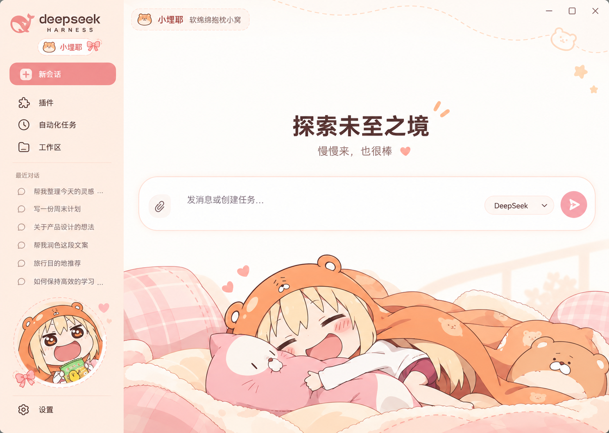

# 小埋耶·抱枕小窝

适用于 DeepSeek Harness（DSH）的独立主题。桃粉色、奶油白和小埋抱枕插画，为新会话页面添一点软绵绵的气氛。

**当前版本：1.0.2** · [下载安装包](https://github.com/dingfz-cyber/dsh-theme-umaru-cuddle/releases/tag/v1.0.2)

## 设计参考

下图是本主题采用的**设计参考图，并非 DSH 实机截图**。实际界面会随窗口比例、侧栏宽度及 DSH 原生控件变化。



## 安装

### 使用 GitHub 地址

1. 打开 DSH 的 **插件 → 添加插件**。
2. 填入以下仓库地址并安装：

   ```text
   https://github.com/dingfz-cyber/dsh-theme-umaru-cuddle
   ```

3. 停用当前启用的其他整套主题，再启用 **小埋耶·抱枕小窝**。
4. 打开新会话查看欢迎页面；已有会话会使用同一配色，并降低正文背后的插画浓度。

### 使用 ZIP 本地安装

1. 在 [v1.0.2 发布页](https://github.com/dingfz-cyber/dsh-theme-umaru-cuddle/releases/tag/v1.0.2)下载 `dsh-theme-umaru-cuddle-1.0.2.zip`。
2. 解压到长期保留的目录。
3. 在 DSH 的 **插件 → 添加插件**中填写解压后**包含 `package.json` 的目录路径**，安装并启用。

本地安装后请保留该目录。主题可与「小埋耶」「波奇酱喵喵喵」分别安装，使用时只启用一套整套主题。

## 主题特点

- 使用设计图中的小埋、抱枕、被褥、圆形头像与品牌装饰，搭配桃粉色按钮和宽版圆角输入框。
- 保留 DSH 原生侧栏宽度与拖动手柄，可拖动侧栏右边缘调节，不重写已保存的侧栏宽度。
- 保留真实会话列表及原生工作区、模型、上传、发送、停止等功能，不修改聊天数据。
- 侧栏头像随可用空间缩小，优先为会话列表保留空间。
- 图片与样式内嵌在构建产物中，安装后的主题外观不依赖远端素材。

## 版本说明

这是本仓库首次发布，**1.0.2 已包含前两轮修正**：

- **1.0.2：重影修复。** 顶部背景与底部原图插画分区显示，避免已有会话及深色模式下半透明图层叠出两套人物轮廓。
- **1.0.1：布局修正。** 修正主区域左侧大块空白，输入框随主区域宽度铺开；调整欢迎标题、侧栏导航及会话行距，并保留输入框下方的工作区与模式控件。

## 显示与适配说明

设计基准为 **1487 × 1058**，设计中的侧栏宽度为 **302**。实际侧栏宽度仍由用户拖动决定；底部人物等比缩放，宽屏可能裁掉部分底部被褥。系统标题栏、窗口比例、文字长度和 DSH 原生控件都会影响最终排版，设计图中的示例会话会由你的真实会话替代。

适配依据为 **DSH 0.2.1-rc.3** 的原生界面结构。按用户要求，本版完成了实现与构建，**未执行自动测试或界面验收**；侧栏拖动、会话切换和实际视觉效果留待用户手动检查。

## 源码与素材

- `src/`：主题样式、颜色注册及装饰挂载逻辑。
- `lib/`：可直接安装的构建结果。
- `assets/design-source.png`：选定的设计参考原图。
- `assets/room-clean.png`：用于顶部区域的去 UI 背景素材；底部人物使用原图细节。
- `assets/room-clean.txt`：背景生成提示词。

修改源码后运行 `npm run build`，再重新加载主题。素材和代码的使用条件见 [LICENSE](LICENSE)。
